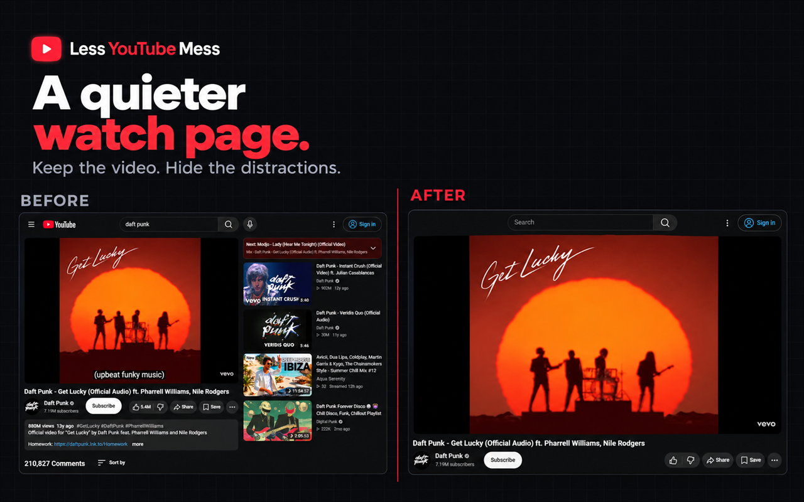
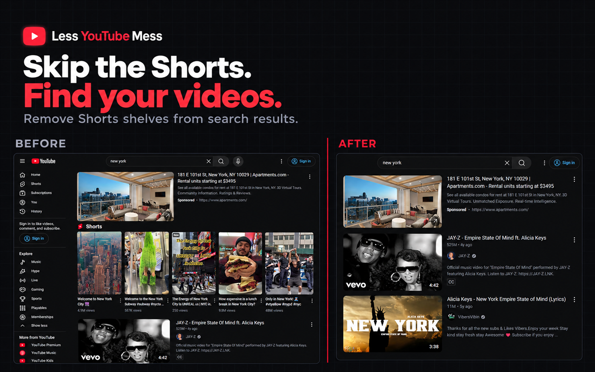
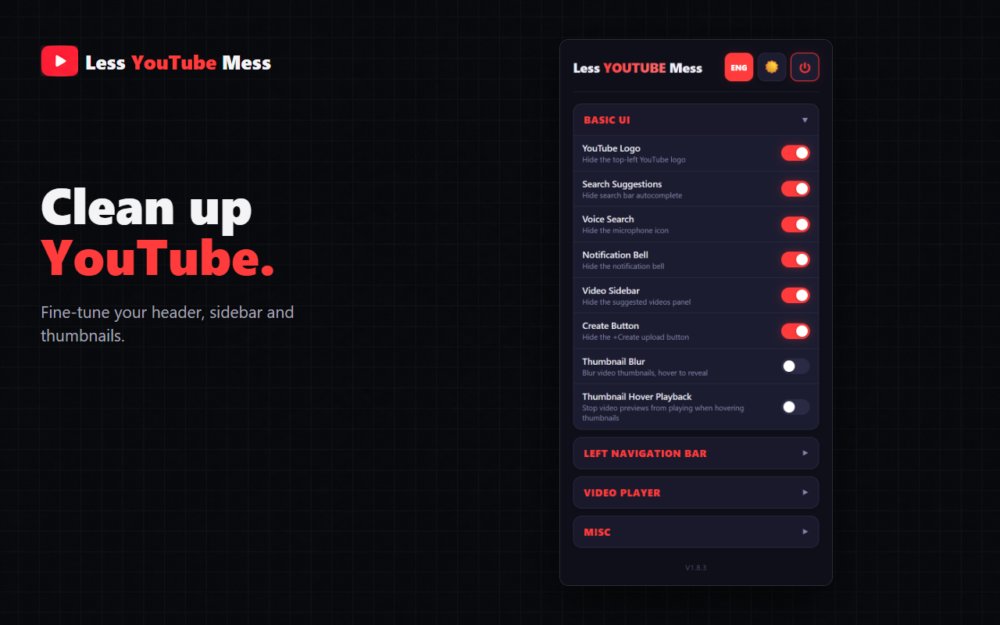
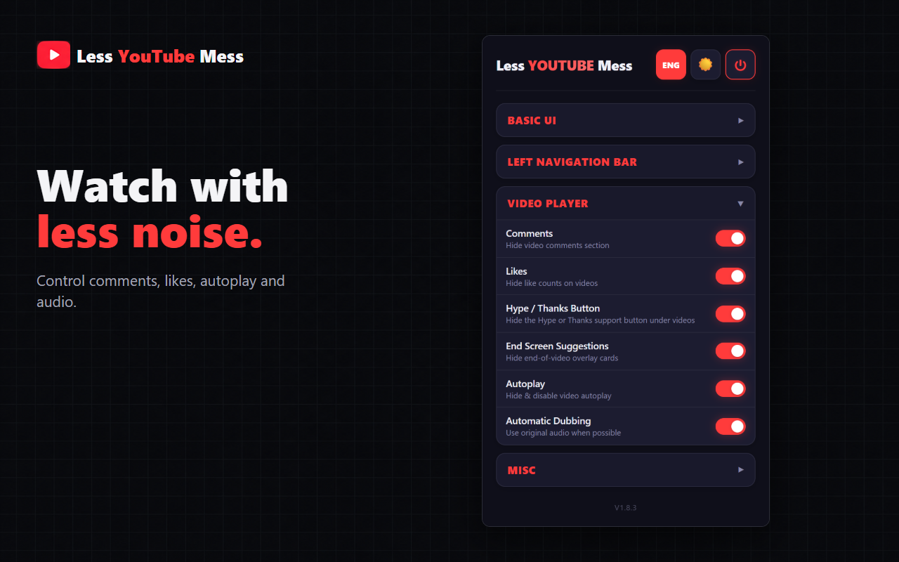
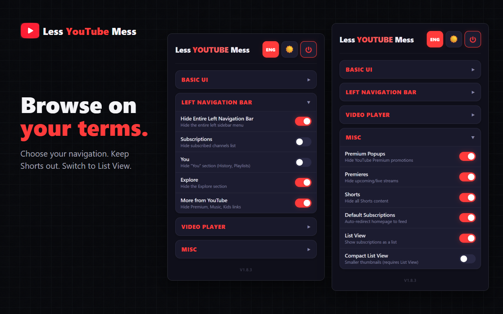

# Less YouTube Mess

Hide distractions and keep the parts of YouTube you enjoy.

**[Install from the Chrome Web Store](https://chromewebstore.google.com/detail/less-youtube-mess/opoonnlbochomodkkaflhdfmghbbikkb)**

## Make YouTube Yours

- Hide Shorts, Premium popups, and live or premiere videos.
- Remove recommendations, comments, like counts, and end-screen suggestions.
- Clean up the header and left navigation.
- Browse subscriptions in List View, with an optional compact layout.
- Blur thumbnails or stop their hover previews.
- Turn off autoplay or prefer original audio when available.

Choose from **25 individual settings**, with a popup available in **24 languages** and an English switch. Every feature is optional.

## Your Settings, Your Choice

Keep what you use and hide what you do not. The main power button lets you turn the extension off without losing your preferences.

See the settings

## Get Started

1. Install the extension from the Chrome Web Store.
2. Open YouTube, or refresh an existing YouTube tab.
3. Open the extension and turn on the options you prefer.

Requires Chrome 105 or newer, or a compatible Chromium-based browser.

## Privacy

No analytics, tracking, or separate account. Feature settings are saved with Chrome's storage and can sync between your signed-in browsers.

## Help and Contributions

Found a bug or have an idea? [Open an issue](https://github.com/Atakan0zkan/Less-Youtube-Mess-Extension/issues).

For local setup, testing, and technical details, see the [development guide](docs/DEVELOPMENT.md).

## License

Copyright (C) 2026 [Atakan Özkan](https://atakanozkan.com/en/extension). Licensed under [AGPL-3.0-only](LICENSE). See [COPYRIGHT](COPYRIGHT) for the project notice.

Earlier revisions published under MIT retain their original terms.
